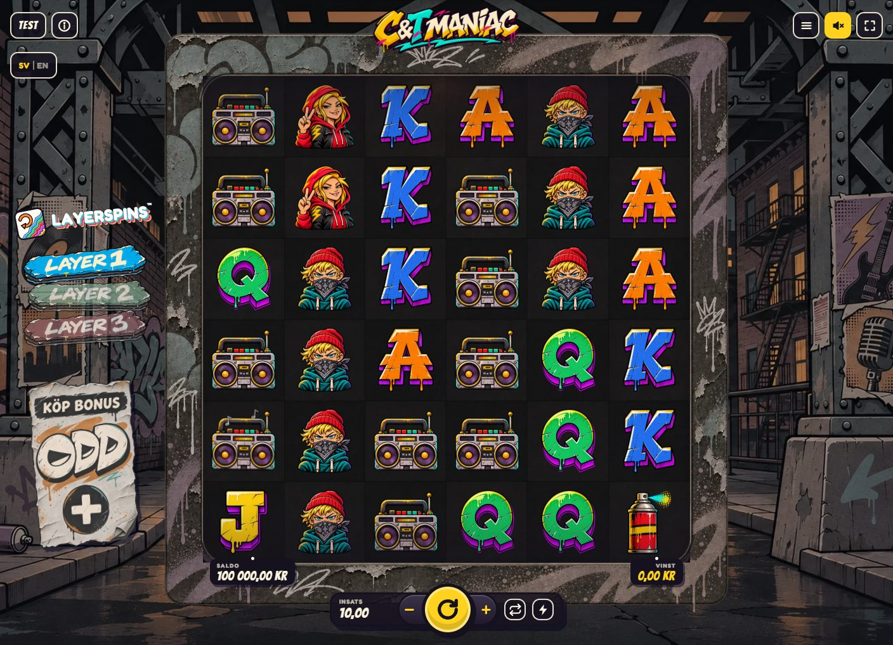
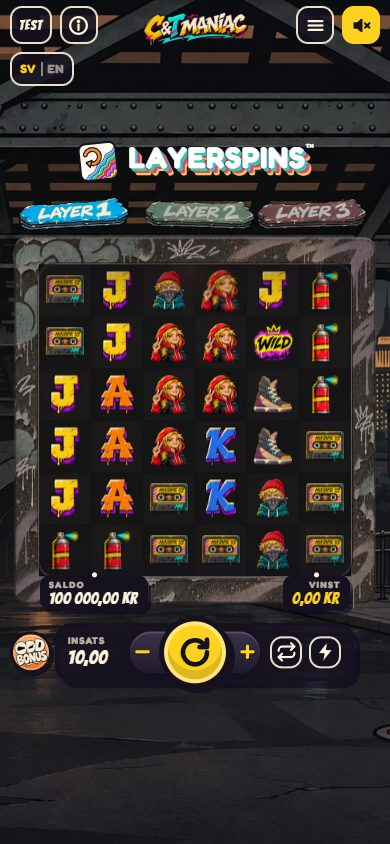
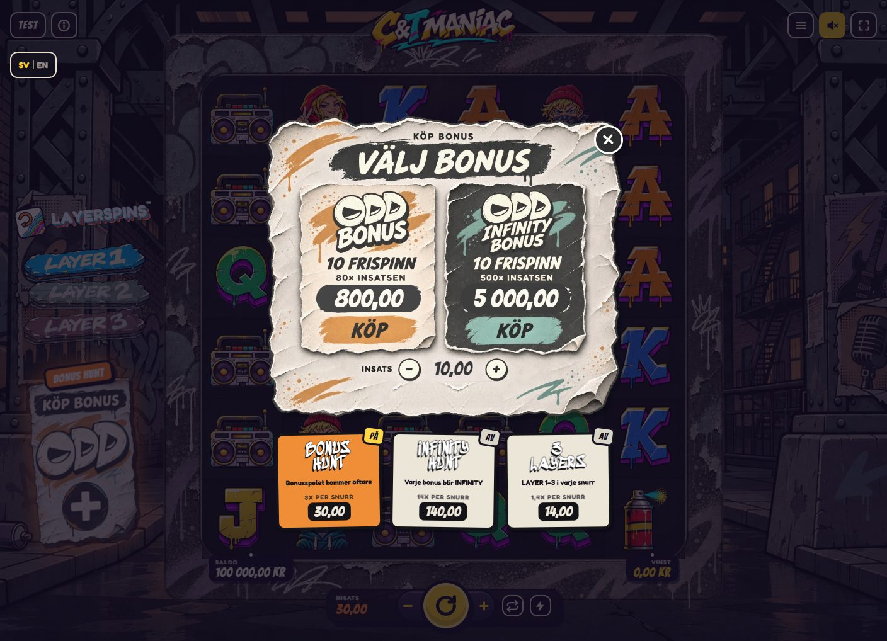
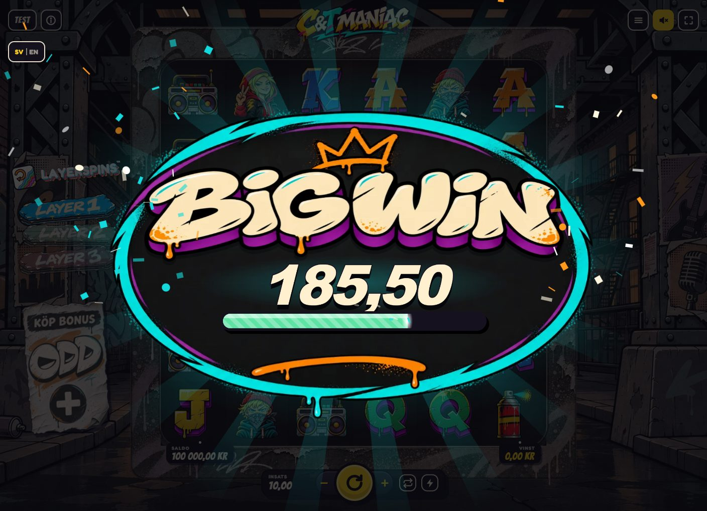

# UI-bas från C&T Maniac (för ALTER EGO och alla kommande spel)

C&T Maniac är grunden för hur alla ODD HEAD-spel ser ut och fungerar. Ett nytt spel byter **tema och bilder** men behåller **platser, storlekar, knappar och flöden**. Allt i det här dokumentet är uppmätt i den senaste versionen av C&T Maniac (prototyp v50 + lokala ändringar, 2026-11-10).

Bilderna ligger i `bilder/` bredvid den här filen.

---

## 1. Hårda regler (gäller alla spel)

1. **Fast design, skalas som en bild.**
   - Dator ritas för **1408 × 1018 px**, telefon (stående) för **390 × 844 px**.
   - Hela spelet skalas med CSS-variabeln `--uiz` och centreras, till exempel `--uiz: 0.7466` på 1536 × 760.
   - Använd `--gvh` / `--gvw` i stället för `vh` / `vw`.
   - Be aldrig spelaren zooma med Ctrl+0.
2. **Layouten flyttar sig aldrig.** Nytt läggs ovanpå som overlay och får aldrig flytta eller ändra storlek på något som redan finns: intro, bräde, vänsterkolumn, köpaffisch, knapprad. Kontrollera pixel för pixel mot förra versionen.
3. **Telefonen alltid.** Allt ska fungera och vara kontrollerat i 390 × 844 också.
4. **Samma storlekar som C&T.** Mät ett nytt spel mot C&T i 1408 × 1018, 1536 × 760 och 390 × 844.
5. **Vinster visas som belopp.** Pratbubblor och vinstsmällar visar bara siffror. Ramarna på brädet visar vad som vann. Inga texter som "vinner alltid minst …" och inga sannolikheter som "1 på N" i spelartexter.
6. **Färger:**
   - Orange är accentfärgen, aldrig rosa.
   - **Guld** används bara för det största: INFINITY och maxvinst.
   - Bonusrutan är lila.
7. **Språk och valuta.** Knappen SV | EN byter mellan Svenska · kr och English · €. Alla texter skrivs som `txl('…')` med engelsk översättning.

---

## 2. Datorn (1408 × 1018)



```
┌───────────────────────────────────────────────────────────────────────────────┐
│ [TEST][i]                  ╔═ C&T MANIAC ═╗                   [≡][🔊][⛶]    │
│ [SV|EN]                                                                       │
│              ┌──────────────── RAM 810×810 ────────────────┐                  │
│ LAYERSPINS™  │  ┌─────────── BRÄDE 6×6, 768×768 ─────────┐ │   (bakgrunds-    │
│ [LAYER 1]    │  │  rutor 128×128                          │ │    konst, gata,  │
│ [LAYER 2]    │  │                                         │ │    tegel, järn)  │
│ [LAYER 3]    │  │                                         │ │                  │
│ ┌─────────┐  │  │                                         │ │                  │
│ │KÖP BONUS│  │  └─────────────────────────────────────────┘ │                  │
│ │  ODD    │  │ SALDO 100 000,00 KR             VINST 0,00 KR│                  │
│ │   (+)   │  └──────────────────────────────────────────────┘                  │
│ └─────────┘        [INSATS 10,00][−]( SPIN )[+][⟳][⚡]                          │
└───────────────────────────────────────────────────────────────────────────────┘
```

### Uppmätta rutor (x, y, bredd, höjd i px vid 1408 × 1018, `--uiz: 1`)

| Del | id / klass | x | y | b | h | Not |
|---|---|---|---|---|---|---|
| Hela spelet | `#game` | 0 | 0 | 1408 | 1018 | |
| Mittytan | `#mid` | 16 | 80 | 1376 | 928 | |
| Vänsterkolumn | `#left` | 16 | 80 | 235 | 928 | LAYERSPINS, lagerbrickor, köpaffisch |
| Maskinen (ram + saldorad) | `#machine` | 299 | 99 | 810 | 890 | |
| Ramen | `#frame` | 299 | 99 | 810 | 810 | ramkonsten (neon/graffiti) |
| Scenen | `#stage` | 315 | 115 | 778 | 778 | |
| **Brädet** | `#board` | 320 | 120 | **768** | **768** | 6 × 6, ruta **128 px** |
| Logga | `.logo` | 546 | −1 | 315 | 82 | bild, ligger över ramens överkant |
| Lagerbrickor | `#baseLag` | 45 | 307 | 176 | 248 | LAYER 1–3 under LAYERSPINS-märket |
| Köpknappen (affischen) | `#btnBuy` | 26 | 586 | 216 | 292 | "KÖP BONUS / ODD / +" |
| SALDO-belopp | `#balance` | 342 | 899 | – | 20 | Bangers 20 px, ljus |
| VINST-belopp | `#win` | 1005 | 899 | – | 20 | Bangers 20 px, **gul #ffd21f** |
| Knappraden | `#bar` | 520 | 935 | 368 | 54 | mörk pill `rgba(21,17,31,.84)` |
| Insats (fält) | `#betVal` / `#bet` | 533 | 943 | 84 | 39 | Bangers 22 px |
| Minus | `#betDown` | 627 | 942 | 46 | 40 | gult tecken |
| **SPIN** | `#spin` | 665 | 921 | **82** | **82** | rund, gul `#ffd21f`, mörk ikon, sticker upp ur raden |
| Plus | `#betUp` | 739 | 942 | 46 | 40 | |
| Autospel | `#btnAuto` | 795 | 945 | 34 | 34 | mörk ruta `rgba(21,17,31,.82)` |
| Turbo | `#btnTurbo` | 839 | 945 | 34 | 34 | |
| TEST (bara under utveckling) | `#btnTest` | 16 | 19 | 57 | 42 | tas bort i färdig produkt |
| Info | `#btnInfo` | 81 | 19 | 42 | 42 | |
| Språk SV \| EN | `#btnLang` | 16 | 82 | 74 | 42 | |
| Meny | `#btnMenu` | 1250 | 19 | 42 | 42 | |
| Ljud | `#btnSound` | 1300 | 19 | 42 | 42 | gul bakgrund |
| Helskärm | `#btnFull` | 1350 | 19 | 42 | 42 | bara dator |

Topprundknapparna är 42 × 42 px mörka rutor med ljus ikon och ljus kant. På 1536 × 760 blir allt ×0,7466 och centreras ([bild](bilder/dator-1536x760-bas.jpg)).

---

## 3. Telefonen (390 × 844, stående)



Upplägget uppifrån och ned:
1. Topprad med TEST, info, logga i mitten, meny och ljud. Ingen helskärm.
2. SV | EN under TEST.
3. Ett stort **LAYERSPINS-märke** centrerat.
4. **Lagerbrickorna i en rad**: LAYER 1, LAYER 2, LAYER 3.
5. Brädet.
6. SALDO och VINST i ramens nederkant.
7. Knappraden. Köpknappen är en **liten rund ODD BONUS-bricka** till vänster om raden.

| Del | id / klass | x | y | b | h |
|---|---|---|---|---|---|
| Mittytan | `#mid` | 10 | 50 | 370 | 784 |
| LAYERSPINS + brickor | `#left` | 10 | 127 | 370 | 104 |
| Lagerbrickor (rad) | `#baseLag` | 17 | 197 | 356 | 33 |
| Ramen | `#frame` | 18 | 243 | 354 | 354 |
| **Brädet** | `#board` | 39 | 264 | **312** | **312** (ruta **52 px**) |
| Logga | `.logo` | 125 | 7 | 140 | 36 |
| Köpbrickan | `.buy-bar` | 10 | 631 | 42 | 42 |
| SALDO / VINST | `#balance` / `#win` | 49 / 292 | 591 | – | 16 |
| Knappraden | `#bar` | 55 | 623 | 299 | 58 |
| SPIN | `#spin` | 159 | 616 | **72** | **72** |
| Minus / Plus | `#betDown` / `#betUp` | 127 / 223 | 632 | 40 | 40 |
| Autospel / Turbo | `#btnAuto` / `#btnTurbo` | 270 / 309 | 636 | 32 | 32 |
| Topprundknappar | `#btnMenu` m.fl. | – | 6 | 38 | 38 |

---

## 4. Färger och typsnitt

### Färgtoken (`:root`)

| Token | Värde | Används till |
|---|---|---|
| `--ink` | `#15111f` | mörk grund, konturer, text på gult |
| `--paper` | `#fff6e0` | ljus text och papper |
| `--sun` / `--frame` | `#ffd21f` | SPIN-knappen, VINST-beloppet, ljudknappen, plus/minus |
| `--pink` (är **orange**) | `#ff8629` | accent, påslagna lägen, taggar |
| `--pop` | `#ff3b3b` | rött (LAYER 3-märket, varningar) |
| `--sky` | `#1d47d1` | blått |
| `--mint` | `#3ccf6e` | grönt |
| Mörka knappar | `rgba(21,17,31,.82)` | topprundknappar, autospel, turbo |
| Knappraden | `rgba(21,17,31,.84)` | |

### Typsnitt (Google Fonts)

| Roll | Typsnitt |
|---|---|
| Rubriker, belopp, insats, SALDO/VINST | **Bangers** (`--display`) |
| Vanlig UI-text | **Fredoka** (`--ui`) |
| Graffiti, loggan | **Sedgwick Ave Display**, Rubik Spray Paint, Permanent Marker, Knewave |
| Bandräknare (kassetten) | **VT323** |
| Övrigt | Titan One, Anton |

Före lansering på Stake Engine måste typsnitten bäddas in i filen, eftersom inget får laddas utifrån.

---

## 5. Brädet och symbolerna

- **6 × 6, ways, laviner.** Vinnande symboler sprängs och nya faller in.
- **Rutorna:** symbolerna är frilagda bilder på mörka rutor med ett mjukt sken. Brädet är mörkt.
- **Vanlig vinst:** ingen ram. Ett vitt sken längs symbolens kontur och en studs när **Ljuskulan** sveper förbi, sedan andas symbolen lugnt. Beloppet visas i en liten bubbla, bara siffror.
- **Lagervinst (Layerspins):** tjock ram i lagrets färg och en stor siffra i hörnet.
- **Bonussymbol:** sprayburken (OH BONUS). När bonusen utlöses gör den OH!-ropet: squash och stretch plus serietidningsstrålar.
- **Stängslet:** när ett snurr kan ge bonus byggs ett stängsel över hjulen som väntar, med hjärtslag och puls. Det kommer bara vid hjulens landning, aldrig i lavinerna.
- **Vilo-animationer** (nytt 2026-11-10, lokalt): när brädet står still vaknar en symbol i taget i ungefär 1,5 s:
  - bandspelarens högtalare med noter
  - sneakern hoppar och dammar
  - burken skakar och puffar
  - kassetten gungar
  - bokstäverna hoppar och glimmar
  - Carla och Ted nickar

  Allt stannar direkt vid SPIN.
- **Hjulens start, snurr och stopp** är heliga. De ändras inte.

---

## 6. Vänsterkolumnen: LAYERSPINS och lagren

- **LAYERSPINS™-märket:** ordet i **vitt med svart kontur** överallt, med en liten färgglad ikon.
- **Lagerbrickorna LAYER 1, LAYER 2 och LAYER 3** är målade brickor:
  - LAYER 1 är blå, LAYER 2 grön och LAYER 3 röd.
  - En bricka som inte är aktiv är **grå**.
  - En bricka tänds först när lagret faktiskt landar: brickan flyger in och lyser upp en gång.
- **Kassetten:** i grundspelet kan en bandspelare dyka upp under brädet. Kassetten trycks in, spolar bakåt och lagren 2–3 tänds.
- **Telefon:** samma brickor i en rad över brädet, under ett stort LAYERSPINS-märke.

---

## 7. Köpknappen och ODD-menyn



**Köpknappen, dator:** en riven papperslapp med "KÖP BONUS", ODD-loggan och en rund **+**. **Telefon:** en liten rund ODD BONUS-bricka till vänster om knappraden.

**ODD-menyn** öppnas när man trycker på köpknappen. Den består av:
1. Användarens målade pappersbild med rubriken "KÖP BONUS / VÄLJ BONUS".
2. Två kort:
   - **ODD BONUS**: 10 frispinn, **80× insatsen**, pris och **KÖP** i orange.
   - **ODD INFINITY BONUS**: 10 frispinn, **500× insatsen**, pris och **KÖP** i turkos.
3. **INSATS − 10,00 +** inne i menyn.
4. **Stängs med ett runt svart kryss uppe till höger.** Det finns ingen STÄNG-knapp.
5. Under bilden ligger **tre lägesknappar**, som är vanliga tryckknappar. En liten ruta i övre högra hörnet visar **AV** eller **PÅ**. Påslagen knapp blir orange och rutan gul med "PÅ".

| Läge | Pris per snurr | Vad det gör |
|---|---|---|
| **BONUS HUNT** | 3× | bonusspelet kommer oftare |
| **INFINITY HUNT** | 14× | varje bonus blir INFINITY |
| **3 LAYERS** | 1,4× | LAYER 1–3 i varje snurr |

**När ett läge är på** ([dator](bilder/dator-4-bas-med-hunt-tagg.jpg), [telefon](bilder/telefon-4-bas-med-hunt-tagg.jpg)):
- Insatsfältet visar vad ett snurr kostar, i lägets färg.
- Över köpknappen sitter en tagg:
  - Dator: "BONUS HUNT" eller "INFINITY HUNT", orange och lätt pulserande.
  - Telefon: **BH** eller **IH**, centrerad.
- 3 LAYERS visar i stället det **röda L3-märket** centrerat, och LAYER 1–3 lyser.

**Köpbekräftelse:** ännu en målad bild med JA, KÖP och AVBRYT ([bild](bilder/dator-7-kop-bekrafta.jpg)).

---

## 8. Storvinst-presentationen



- Visas när en grundomgång vinner **minst 10×** insatsen. Med ett läge på räknas gränsen på snurrets pris.
- **Sju nivåer**, var och en med egen ram och titelkonst:

| Nivå | Från (× insatsen) |
|---|---|
| BIG WIN | 10 |
| EPIC WIN | 20 |
| MEGA WIN | 50 |
| SUPER WIN | 150 |
| ULTRA WIN | 500 |
| INSANE WIN | 2 000 |
| INFINITY WIN | maxvinsten (guld) |

- Oval graffitiram med krona, titeln i stor graffiti, beloppet som räknas upp och en mätare som fylls mot nästa nivå i nivåns färg.
- Konfettifontäner och små oregelbundna titeltrick: hopp, vippning och dörrsving.
- För att stänga visas en pulserande **vit text utan ruta**: "Klicka var som helst".
- Storvinst-rutan visas inte efter en bonus. Där finns bonusens egen summering.

---

## 9. Bonusflödet

1. **Trigger:** stängslet på hjulen, sedan OH!-ropet på bonussymbolerna.
2. **Bonusaffisch:**
   - Bonusspel: kräm och orange.
   - INFINITY: **guldpapper, svart band och röd titel**.
   - Raderna är desamma på båda affischerna, men de ser aldrig likadana ut.
3. Brädet viks, bandet spelas och frisnurren börjar.
4. **Under frisnurren:**
   - Dator: en bonuspanel högst upp på brädet med snurr kvar, multi och total vinst.
   - Lagren tänds och ett lagersteg tar ungefär 3,5–4 s.
5. **Slut:** rutorna lyser upp och mynt flyger till TOTAL VINST. Därefter vinstpresentation och summering.
6. **Maxvinst:** brädet faller isär, en gammal tv stängs av och presentationen följer.

---

## 10. Intro och start

1. **ODD HEAD-introt:** de tolv bokstäverna flimrar och laddaren följer den riktiga laddningen.
2. **"Hur man spelar":** en mörk, riven affisch med 7 sidor över bakgrunden "Night groove" (bro, lampor, vind och regn).
3. **SPELA:** en gammal tv slås på från mitten, med tv-brus, lampor och ett drop. Spelplanen vaknar i en våg.

---

## 11. Vad ett nytt spel byter och vad det behåller

**Behåll (samma som C&T):**
- alla platser och storlekar i tabellerna ovan
- knappraden: insats, −, SPIN, +, autospel, turbo
- topprundknapparna och SV | EN
- vänsterkolumnens upplägg: märke, lagerbrickor, köpaffisch
- telefonens upplägg
- ODD-menyns struktur: två köpkort, insats i menyn, kryss uppe till höger och lägesknappar med AV/PÅ-ruta
- taggarna på köpknappen
- storvinstens nivåer och flöde
- bonusflödets ordning
- tempo och flyt
- att vinster visas som belopp
- färgtokenens roller

**Byt (spelets eget tema):**
- bakgrundskonst, ramkonst och logga
- symbolbilder och bonussymbol
- köpaffischens och ODD-menyns målade bilder
- storvinstens ramar och titlar
- bonusaffischernas konst
- intro-bakgrunden
- ljudtema och musik, i spelets egen tonart
- figurer och namn

---

## Bilder

| Fil | Visar |
|---|---|
| `dator-1-bas.jpg` | grundspelet, dator |
| `dator-1536x760-bas.jpg` | samma skalat till 1536 × 760 |
| `dator-2-odd-meny.jpg` | ODD-menyn, inga lägen på |
| `dator-3-odd-meny-hunt-pa.jpg` | ODD-menyn med BONUS HUNT på |
| `dator-4-bas-med-hunt-tagg.jpg` | BONUS HUNT-taggen över köpknappen |
| `dator-5-bas-3layers.jpg` | 3 LAYERS på: L3-märket och tända brickor |
| `dator-6-storvinst.jpg` | BIG WIN |
| `dator-7-kop-bekrafta.jpg` | köpbekräftelsen |
| `telefon-1-bas.jpg` | grundspelet, telefon |
| `telefon-2-odd-meny.jpg` | ODD-menyn, telefon |
| `telefon-4-bas-med-hunt-tagg.jpg` | BH-taggen |
| `telefon-5-bas-3layers.jpg` | 3 LAYERS, telefon |
| `telefon-6-storvinst.jpg` | storvinst, telefon |
